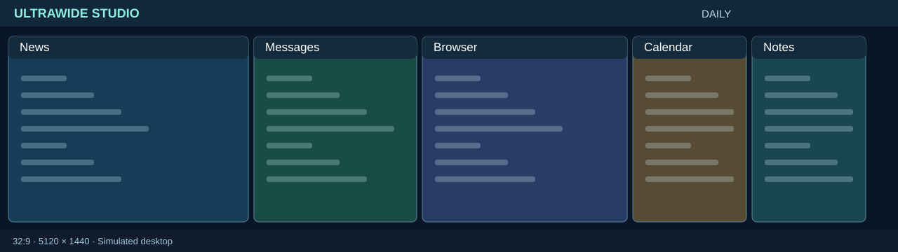
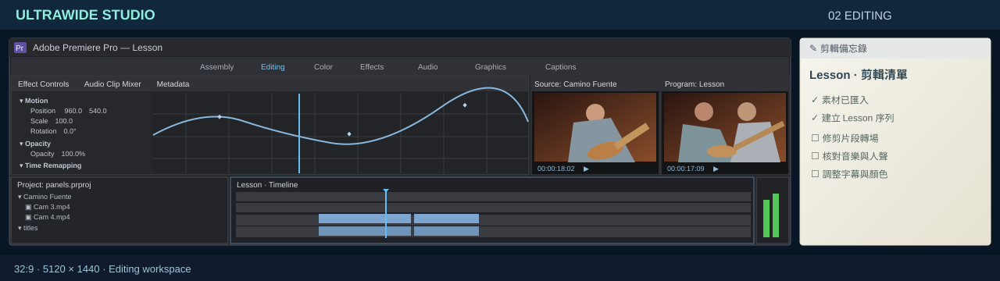

# UltraWide Studio — 5120 × 1440 Virtual Desktop Showcase

以 **32:9（5120 × 1440）超寬螢幕**為目標的互動展示網頁。這是一個模擬桌面，不需要登入聊天軟體、Discord，也不必安裝剪輯器或程式編輯器。畫面採用接近真實桌面應用程式的視覺結構，而非實際可操作的第三方服務。



## 功能

- **場景切換提示**：切換 01／02／03／04 工作區時，右上方工具列下會短暫顯示場景名稱與自由拖曳提示；5 秒後自動淡出、不遮擋點擊。其他操作不會重新顯示這則提示，連續切換則重新計時。
- **自動展示（首頁預設）**：直接開啟網站首頁就會自動啟動，依序播放日常使用、影片剪輯、程式設計、遊戲娛樂四種場景，搭配放大游標導覽；可隨時按「自由操作」停止展示並自行拖曳縮放。明確使用 `?scene=coding` 等場景連結會保留手動預覽模式，首頁也可用 `?mode=manual` 手動開啟。**只有實際觸發功能時才顯示點擊動畫**，例如播放影片、勾選待辦、翻日曆或切換字級；單純聚焦視窗只移動游標並高亮，不再假裝點擊。真正點擊仍以 SVG 箭頭尖端為準。01 日常場景會實際捲動新聞列表並開啟文章預覽、以靜音方式嘗試播放 YouTube 官方嵌入影片、捲動 12 筆示範推薦影片、勾選待辦、切換日曆月份與捲動通訊軟體聯絡人。離開自動模式時，恢復進入展示前的待辦勾選、月份與捲動位置。
- **自由操作**：可拖曳視窗標題列、縮放右下角、最小化／最大化、切換焦點。
- **視窗內容自適應**：依視窗大小調整模擬應用程式版面；應用程式不是實際可操作的生產力工具。
- **自動整理／重設**：切換工作區配置，快速恢復展示。
- **全螢幕展示**：透過網頁按鈕進入全螢幕。
- **新聞文章預覽**：新聞清單可點擊以開啟內部標題／來源預覽；若更新後的 Google News RSS 快照包含文章連結，可按「前往新聞原文」在新分頁閱讀。因新聞網站常禁止 iframe 嵌入，本專案不會偽裝取得新聞全文。 01 日曆顯示開啟頁面當天的年、月和日期，並可翻閱前後月份。
- **YouTube 真實播放**：01 日常場景內使用官方 YouTube iframe 嵌入 [Rick Astley — Never Gonna Give You Up](https://www.youtube.com/watch?v=dQw4w9WgXcQ)。自由操作預設不自動播放，使用者可手動播放／暫停；自動展示模式會嘗試**靜音自動播放**，但能否成功由 YouTube 與瀏覽器播放政策決定。切離日常場景、或最小化影片時會停止載入以避免背景音訊。重新顯示視窗會從頭載入。需連線，可能受瀏覽器擴充套件、影片權限或平台嵌入政策影響。
- **新聞內容**：GitHub Actions 每天兩次（台灣時間 **08:17／20:17**）擷取 Google News RSS 並產生 `news.json`；使用者開啟網站時讀取一次，展示中不改變標題。
- **日常聊天**：依照使用者提供的 LINE 電腦版參考截圖，呈現左側深藍功能列、分類標籤、搜尋欄、聯絡人列表、紅色通知與綠色未讀徽章、底部示範廣告及浮動新增聊天圖示。預設以**聊天列表**為主、不顯示品牌名稱；人物、群組、訊息均為虛構，不使用截圖內的私人資訊。
- **影片剪輯**：依照提供的 Premiere Pro 截圖，把 02 改成單一大型 Premiere 風格主視窗，內部有 Assembly / Editing 工作區列、Source 與 Program 雙監看畫面、Project 素材表格、V1/V2/A1/A2 時間軸及音訊表，整體改成左側約 60% 剪輯面板、右側約 40% 大型 Program 16:9 預覽。所有停駐面板與素材為視覺模擬，不能實際剪輯；自動展示只保留可見的效果區拖曳與播放／暫停動作，播放頭和吉他手畫面隨之變化。
- **遊戲娛樂**：第 4 場景左側為參考 Discord 電腦版的伺服器圖示列、頻道清單、群組聊天、語音連線及使用者狀態，中央是 **嚴格 16:9** 的 YouTube 遊戲影片（ID `1or3YILu28M`），**停止狀態直接顯示該影片的原始 YouTube 預覽縮圖**，按播放後才載入官方播放器，從 **01:27** 開始播放，右側為參考巴哈姆特哈啦區的青綠雙層導覽、文章分類／篩選、討論列表與新聞側欄。改變視窗大小時會自適應，遊戲畫面不會拉伸。Discord 訊息和巴哈討論文章都是虛構展示資料。
- **程式設計 / AI AGENT**：03 左側是腳本式 AI AGENT，先收到正體中文功能需求、顯示「正在分析」，再以台灣慣用語呈現五個修改步驟；中間 Editor 將透過 GitHub Raw 讀取完整 `scripts/fetch_news.py` 真實原始碼，自動導覽模擬人工「捲動 → 新增文字」共五次。右上 GitHub 面板使用公開 GitHub REST API 載入實際專案描述、星數與檔案清單，XS/SM/MD/LG/XL 只控制該面板文字；右下保留 Terminal。AI 回覆、模擬新增程式碼與 Terminal 均不會實際修改 GitHub 儲存庫。



## 使用方法

### 最簡單：純靜態網頁

透過 GitHub Pages 開啟網站即可操作四種場景、視窗動畫和展示功能。亦可用網址參數 `?scene=editing` 直接進入 Premiere 場景，例如 https://knuckleslee.github.io/ultrawide-showcase/?scene=editing 。新聞會從 `news.json` 載入最近一次 Actions 成功擷取的資料；直接以 `file://` 開啟則通常無法取得 JSON，會顯示明確標示的示範資料。

### 即時新聞：Python 本機服務

需安裝 Python 3，無需第三方套件：

```bash
python server.py
```

接著在瀏覽器開啟 <http://127.0.0.1:8765/>。Windows 也可以雙擊 `啟動展示.bat`。

新聞資料由本機 `/api/news` 提供，使用 Google News RSS，每 5 分鐘更新快取一次。來源無法存取時，網頁會保留示範內容而不宣稱其為最新新聞。

## 操作快捷鍵

| 按鍵 | 功能 |
| --- | --- |
| `1` / `2` / `3` / `4` | 切換日常／剪輯／程式／遊戲場景 |
| `Space` | 暫停／繼續自動展示 |
| `R` | 重設當前場景 |
| `F` | 切換全螢幕 |
| `H` | 顯示／隱藏提示 |
| `Esc` | 離開全螢幕 |

## 部署說明

此專案使用 GitHub Actions 排程擷取新聞，並直接發布 GitHub Pages；不依賴外部 API 或常駐伺服器。

1. 開啟 [Repository Settings → Pages](https://github.com/knuckleslee/ultrawide-showcase/settings/pages)，將 **Build and deployment → Source** 設為 **GitHub Actions**（首次啟用必要）。
2. 開啟 [Repository Settings → Actions → General](https://github.com/knuckleslee/ultrawide-showcase/settings/actions) 確認允許 GitHub Actions 執行，且 **Workflow permissions** 可寫入儲存庫內容；工作流程本身宣告 `contents: write`。
3. 前往 [Actions → Refresh news and deploy GitHub Pages](https://github.com/knuckleslee/ultrawide-showcase/actions/workflows/update-news.yml)，按 **Run workflow** 手動執行首次部署。
4. 成功後可開啟 https://knuckleslee.github.io/ultrawide-showcase/ 。Google 新聞排程在 **UTC 00:17、12:17**（台灣時間 **08:17、20:17**）執行，GitHub 可能延後執行，並非即時保證。一般推送 `main` 會重新部署頁面，**不會額外擷取新聞**；手動 `Run workflow` 則可以額外更新一次。

新聞更新只在 GitHub Actions 排程或手動執行時進行，不在瀏覽器內執行爬取。每次進入網頁只讀取一次 JSON。RSS 取得失敗時保留上一版資料；從未成功擷取時則顯示標示清楚的展示內容。`server.py` 仍供本機使用。

## 專案結構

```
index.html           # 虛擬桌面 UI、四種場景、動畫與互動
news.json            # 自動更新的新聞快照
scripts/fetch_news.py # RSS 擷取程式
.github/workflows/update-news.yml # 定時抓新聞與部署 Pages
server.py            # 可選的本機 RSS API 服務
啟動展示.bat          # Windows 啟動器
demo-initial.svg     # 日常模式預覽
demo-editing.svg     # 剪輯模式預覽
README.md            # 使用說明
```

> 聊天、影片剪輯、程式編輯、遊戲、Discord 與巴哈姆特論壇的介面及訊息皆為示意；新聞標題可來自 Google News RSS，但不是嵌入真實 Google 新聞網站。本專案與 Google、LINE、Discord 或巴哈姆特均無官方合作關係。

> GitHub 上的 SVG 預覽為示意圖；原始 PNG 截圖保留在本次提供的完整 ZIP 內。

## 遊戲場景畫面配置

預設在 32:9 桌面中：Discord 風格聊天（左）、**777×437 的 16:9 遊戲影音中央視窗**、巴哈姆特論壇（右）。中央不是 SVG 模擬遊戲，改為 [實際 YouTube 影片](https://www.youtube.com/watch?v=1or3YILu28M&t=87s) 的官方嵌入播放器。一進入遊戲場景就立即顯示 YouTube **原始預覽縮圖**，不會出現「正在定位影片」的載入遮罩；這張縮圖**不代表精確 01:27 的影片影格**。點擊縮圖中央播放鍵，或自動展示進入 04 時，才透過 YouTube IFrame API 載入並從 **01:27** 靜音播放。離開場景、按下暫停或播放結束，會回到原始縮圖；再次播放仍從 01:27 開始。自動展示在播放後會依序捲動左側 Discord 和右側巴哈姆特。若影片不允許嵌入或被瀏覽器禁止自動播放，縮圖仍會顯示，亦可使用影片原站連結繼續。


## 02 Premiere 工作區配置

參考使用者提供的 Premiere Pro 實際截圖，02 場景現在只有一個近乎全寬的 Premiere 主視窗（虛擬桌面座標 `18,54,1884,446`），不再使用外部備忘錄。程式內部為約 **左 60% / 右 40%** 的停駐工作區，類似真實雙螢幕剪輯配置：

- **左上**：Effect Controls（Motion、Opacity、Time Remapping、關鍵影格曲線）加上較小的 Source 16:9 預覽。
- **左下**：Project 素材清單、寬幅 Timeline、Audio Meter。
- **右側整欄**：較大的 Program 16:9 預覽。影片不被拉伸；旁邊利用空間顯示 Lumetri Scopes、解析度、色彩與幀率資訊。

此配置在主程式尺寸改變時會重新計算預覽大小，並在窄視窗中收合部分非核心資訊。自動展示精簡為兩段有實際變化的操作：**拖動 Effect Controls 的分隔線並更新 Scale 數值**，再**點擊 Program 的播放／暫停按鈕**；不再為了依序介紹面板而反覆點擊空白區域。播放期間，兩名吉他手會輕微搖擺與撥弦，時間碼、Timeline 播放頭、關鍵影格播放頭與音量表同步推進；播放／暫停也可在自由操作模式下手動觸發，離開場景會停止播放。預覽內容與功能面板為視覺模擬，無法實際剪輯或匯出影片；示意影像並非從 Premiere 擷取。


## 03 AI AGENT 協作自動展示

1. AI AGENT 的輸入列已向上調整約兩至三行高度，避免被視窗底部遮住。介面文字、思考狀態、五步修改建議及示範編修標題都使用台灣正體中文（程式語法、技術識別字和 XS/SM/MD/LG/XL 維持原樣）。自動展示會輸入「請問如何替 GitHub 視窗加入五種字體大小，並確保不會影響其他視窗？」，顯示三段「正在分析」進度，再以**台灣正體中文**逐步輸出五項修改建議（預先編排，不是真正的 AI 推論）。
2. Editor 從 `raw.githubusercontent.com` 載入真實的 `scripts/fetch_news.py`；來源資訊改為獨立的緊湊狀態列（如 `GITHUB / MAIN / FETCH_NEWS.PY / SYNCED`），避免來源中文標籤的字體和程式碼混雜。使用者可以捲動查看。自動展示會五次捲動並**逐字打出**五段僅存在於展示 UI 的示範程式碼。
3. 右上角 GitHub 面板從公開 API 讀取此儲存庫的資料與目錄，並從 GitHub Raw 載入**真正的 README 文字**。自動展示會**先捲動到 README 文字較密集的區段**，再依序切換 **XS / SM / MD / LG / XL**；每次切換都維持 README 內容可見，僅改變 GitHub 面板內文大小。其他軟體字級不受影響。
4. 退出自動展示後，還原 GitHub 原本字級與編輯器捲動位置；沒有真正的程式寫入、Git 提交或伺服器修改。

GitHub 完整網站通常禁止被第三方 iframe 嵌入，因此這裡載入的是官方 API / Raw 的真實內容，而不是假裝放入整個 GitHub 網站。資料取得失敗會明確標示，並提供可點擊的原站連結。
